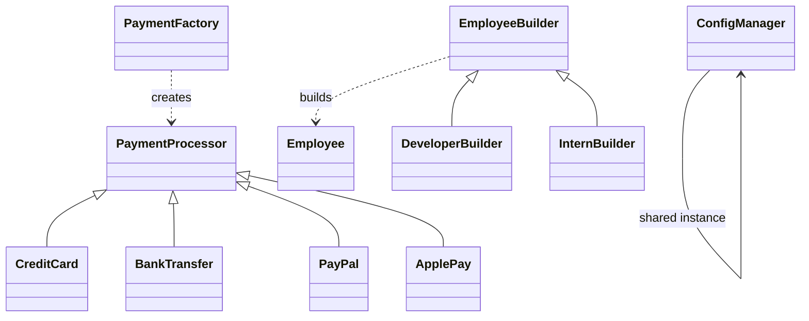
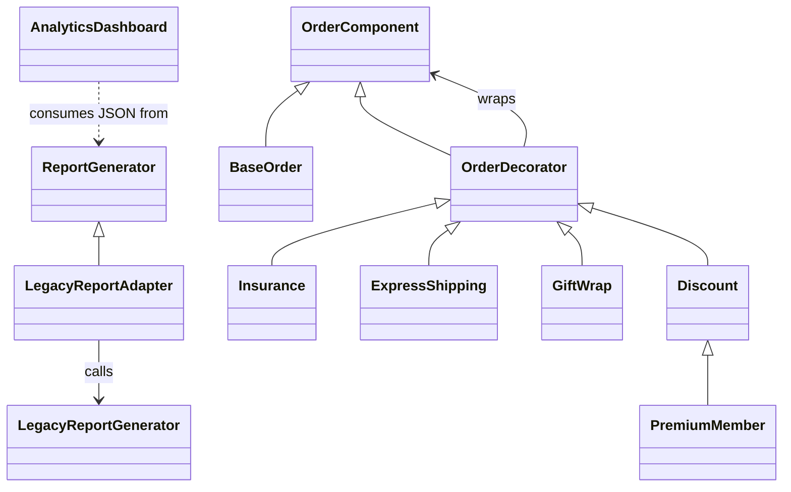
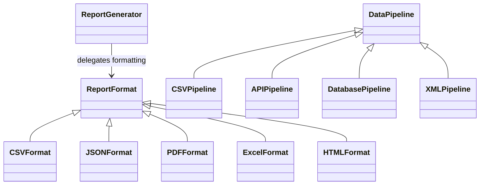

# Design patterns in practice

Slide 84 asks for seven refactorings. The tests show the expected outputs and how to use each class. Run `python -m unittest discover -s design-pattern-in-practice -v` from the repository root.

## Creational

The payment factory looks up processors in a registry. Apple Pay is registered without changing the existing processor classes. The employee builder gathers named values, applies role presets, and validates required fields at build time. The configuration manager loads JSON on first use and shares in-memory changes across callers.

## Structural

The adapter converts the legacy generator's XML into JSON for the dashboard. Pricing decorators wrap an order and adjust the previous layer's subtotal. Apply insurance first to match the legacy example. At a base of 100, adding insurance, express shipping and gift wrap, followed by a 15% coupon and a 10% member discount, gives 95.625 before currency rounding.

## Behavioral

Report generation and saving delegate to the same format strategy, so adding HTML requires one new class. The PDF and Excel examples output a text preview and a tab-separated report, respectively. The ETL template keeps validation, loading and cleanup in one place. Each source defines extraction and transformation, and the database pipeline can start a transaction through a hook.

