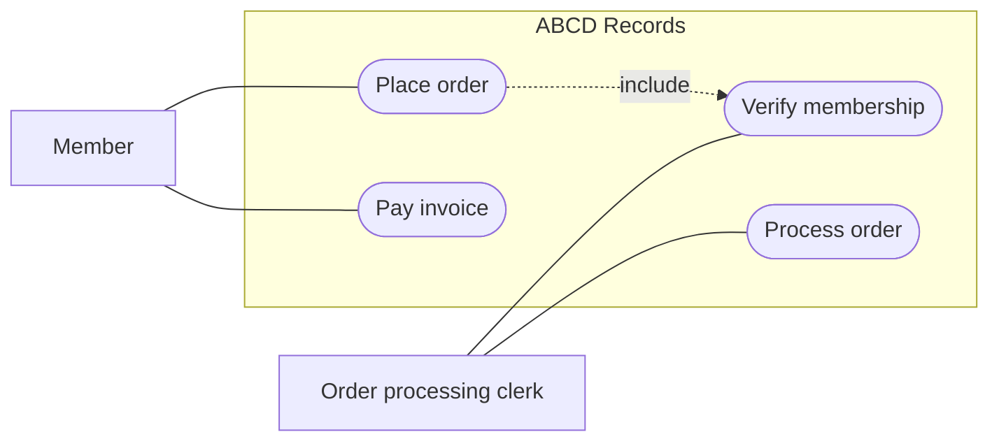
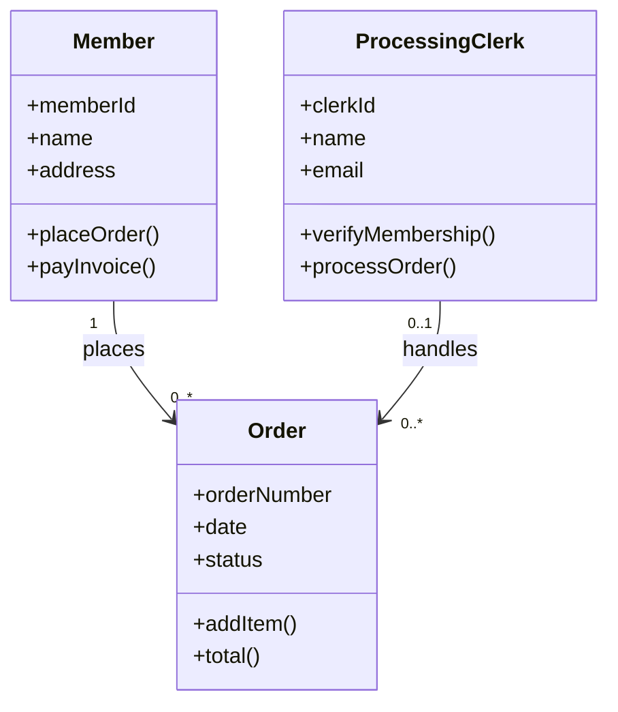
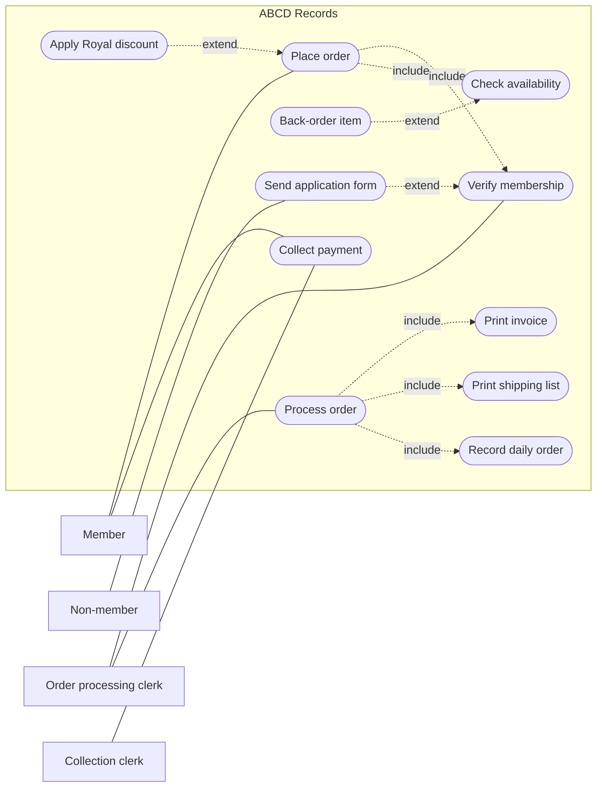
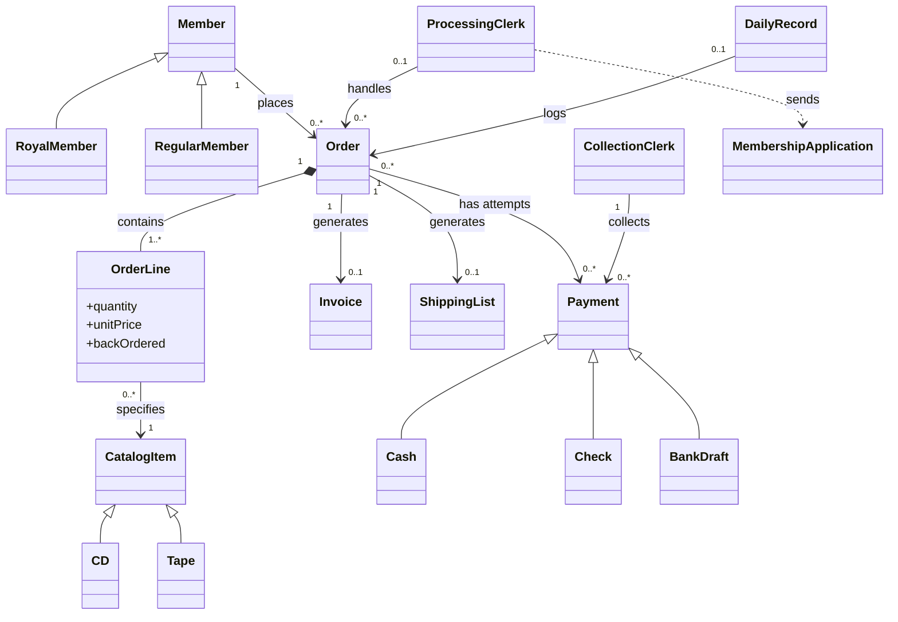
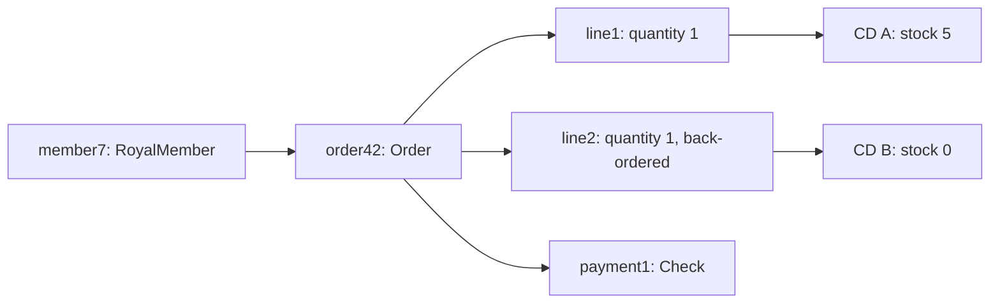
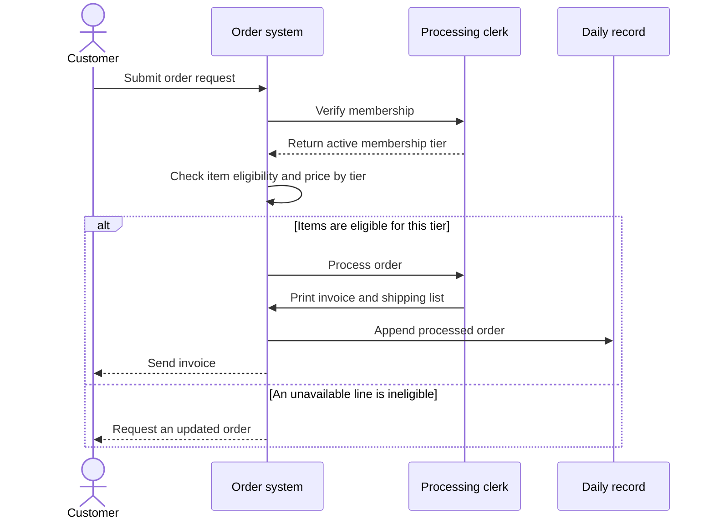
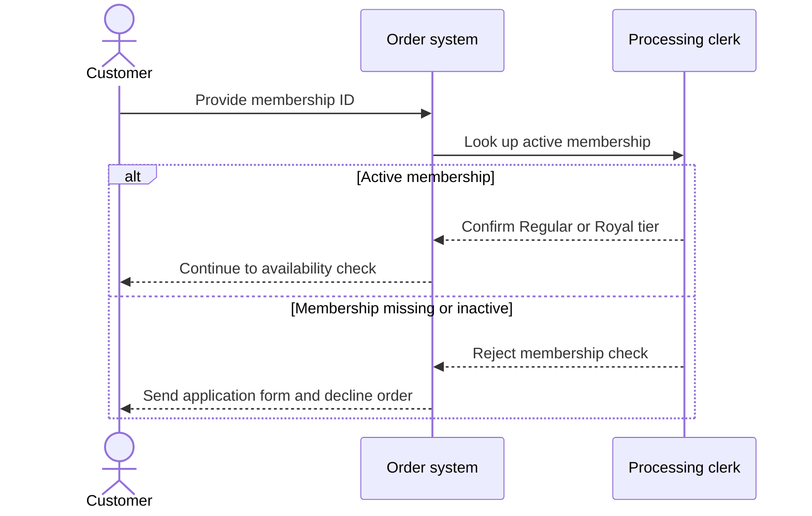
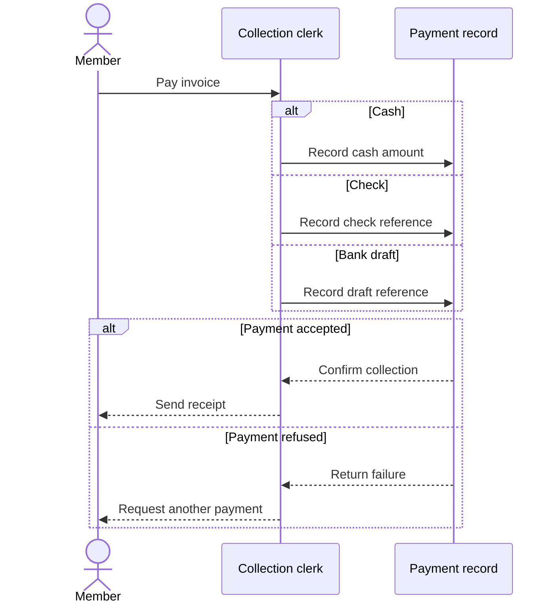
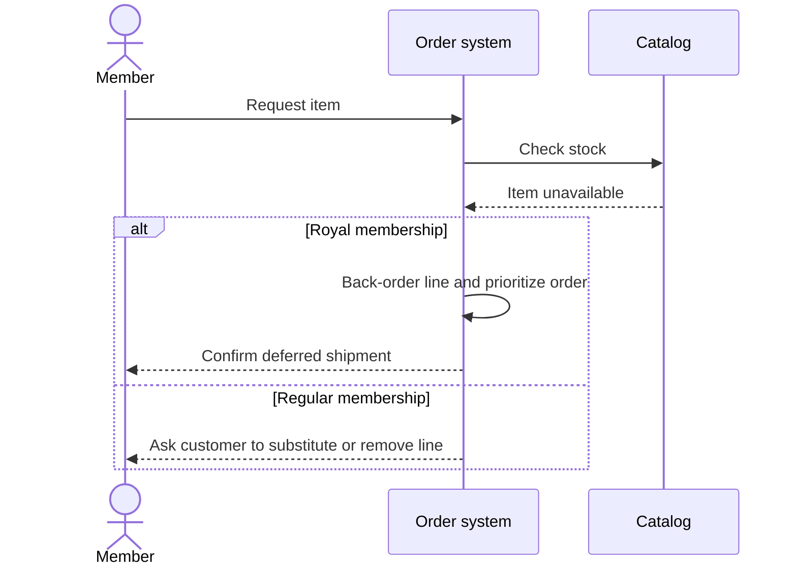

# ABCD Records

Regular and Royal members order CDs and tapes by mail. Royal membership adds a discount, priority, and permission to back-order unavailable items.

## Level 1 · Core use cases

Members place and pay for orders. The processing clerk verifies membership and processes orders.

## Level 1 · Core classes

Each order belongs to one member. A newly submitted order can await clerk assignment.

## Level 2 · Expanded use cases

Membership and availability are required checks. An application is sent when membership fails. Discount and back-order extensions apply to eligible Royal orders.

## Level 2 · Expanded classes

An order owns one or more lines and each line references one catalog item. Orders can await their invoice or shipping list. A daily record groups all orders processed that day.

## Level 2 · Order example

Order 42 has one available CD, one back-ordered CD and a check payment.

## Level 3 · Order processing and membership verification

Accepted orders generate dispatch paperwork and appear in the daily record.

## Level 3 · Membership verification

Invalid membership ends the ordering flow with an application form.

## Level 3 · Payment collection

The collection clerk records the outcome and sends a receipt for accepted payments.

## Level 3 · Unavailable items

Only Royal members can keep unavailable items on an order.
