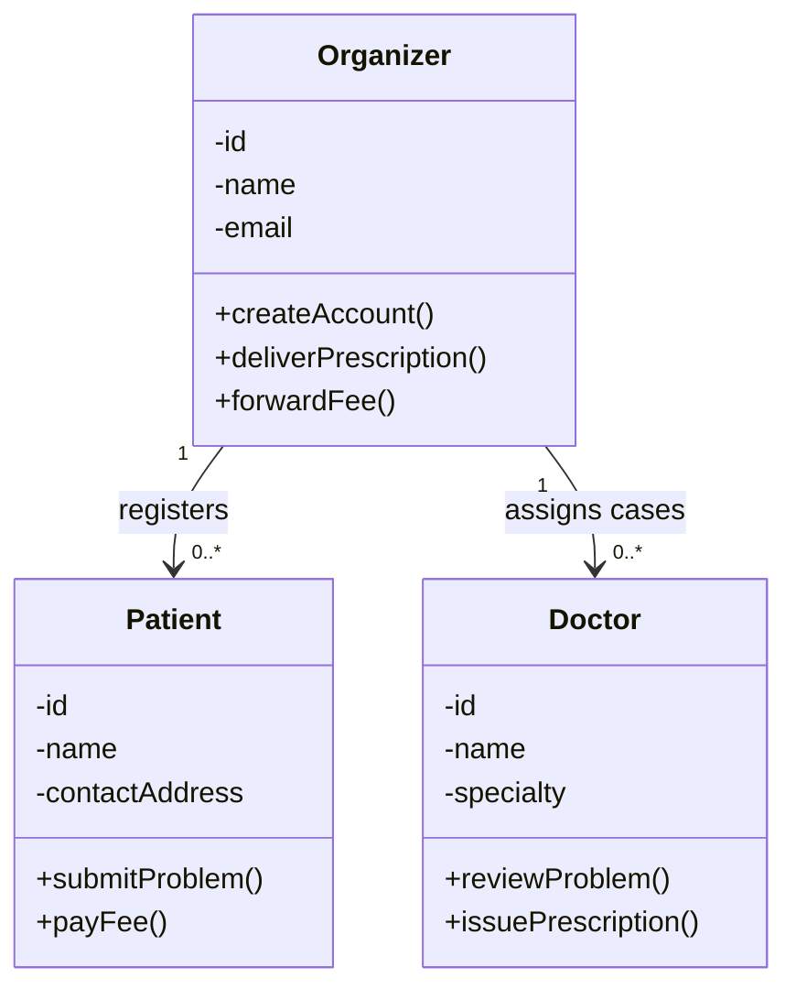
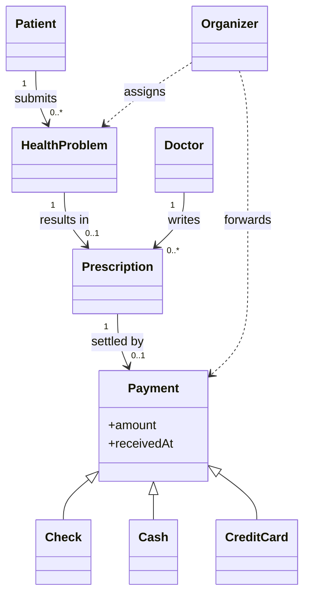
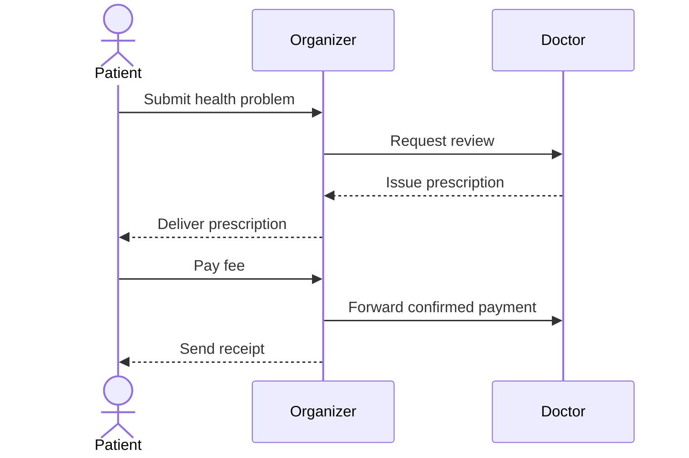
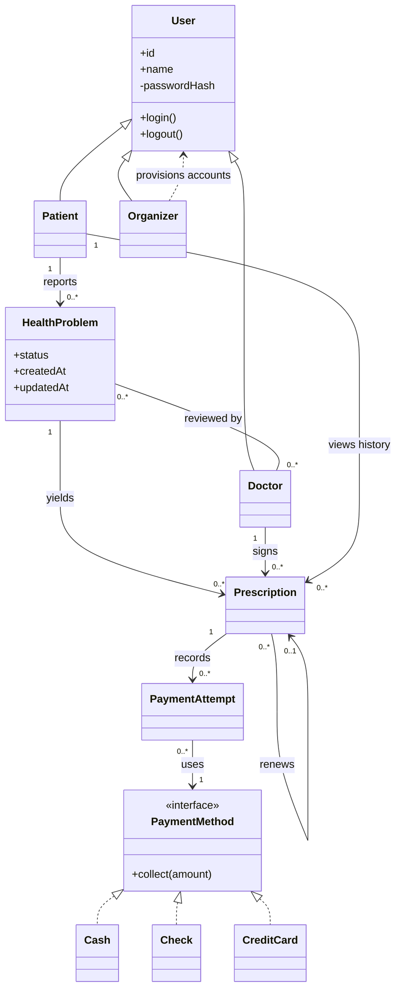
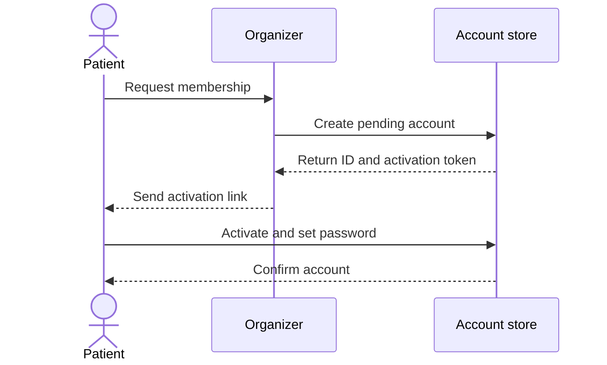
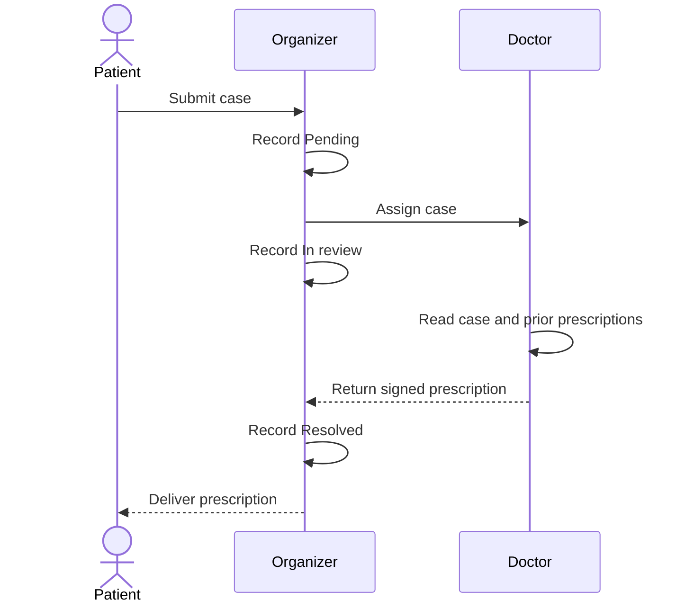
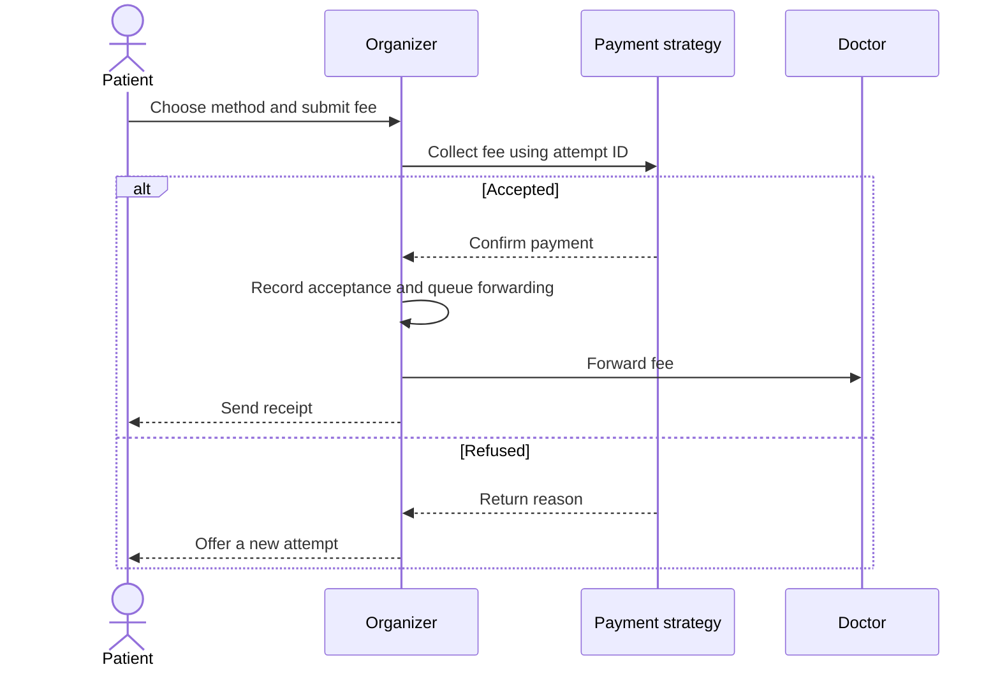

# Hospital management

The organizer assigns patient problems to doctors, delivers prescriptions, collects fees, and manages member accounts.

## Task 1 · Roles

A patient has one organizer. An organizer can support any number of patients and doctors.

## Task 2 · Consultation records

A problem can await a prescription, and a prescription can await payment. Each payment has one prescription.

## Task 2 · End-to-end consultation

The organizer mediates the conversation and payment.

## Task 3 · Accounts, review history and payment strategies

Cases awaiting review can have zero reviewers. A case can later have several reviewers and several prescriptions, each signed by its own doctor. Renewals point to earlier prescriptions. Each prescription can have several payment attempts.

## Registration

The database assigns an account ID. The patient sets a password through an activation link.

## Review and prescription

A case progresses from Pending to In review to Resolved.

## Payment outcomes

Validate the amount first and assign a unique attempt ID. Record acceptance and queue forwarding together in the database. Retry forwarding with the same reference to avoid duplicate transfers.
